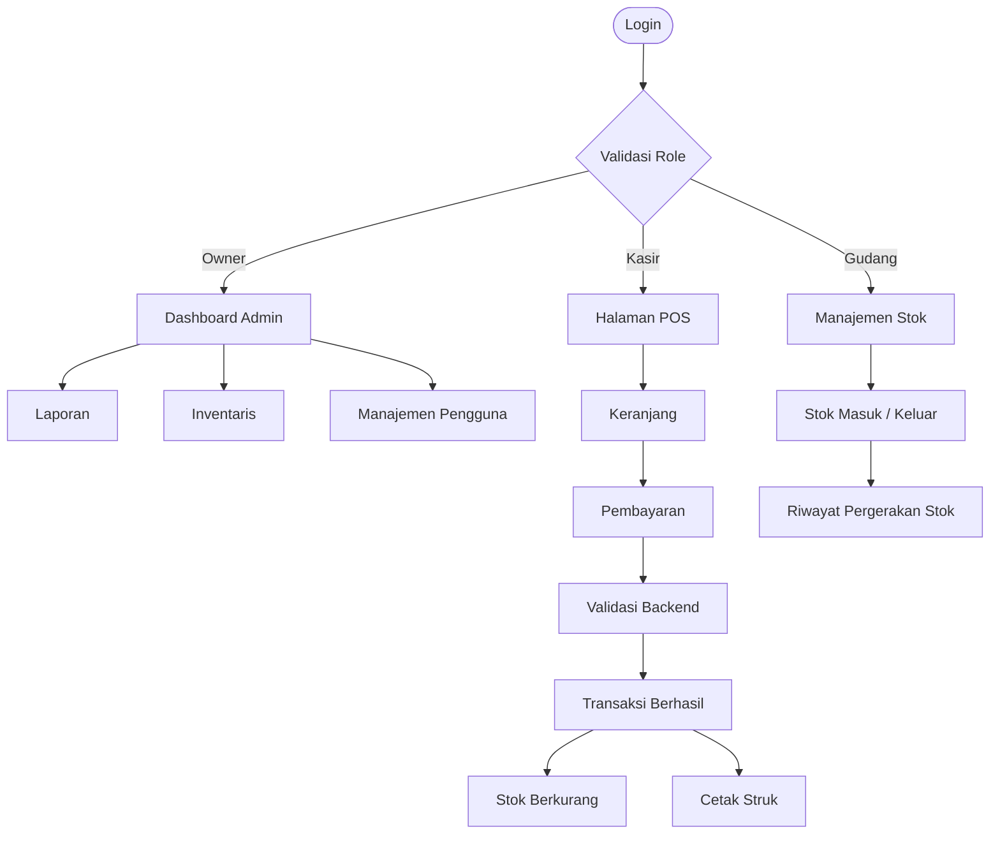

<div align="center">

<h1>🔧 My Bengkel App</h1>
<h3>Sistem Manajemen Bengkel Berbasis Web</h3>

<p>Mengelola transaksi, inventaris, pergerakan stok, pengguna, dan laporan operasional bengkel dalam satu aplikasi.</p>

<p>
  
  
  
  
</p>

<p>
  <a href="#-fitur-utama">Fitur</a> •
  <a href="#-teknologi">Teknologi</a> •
  <a href="#-alur-sistem">Alur Sistem</a> •
  <a href="#-instalasi">Instalasi</a> • 
  <a href="#-roadmap-pengembangan">Roadmap</a>
</p>

<p><a href="https://github.com/muhammadnafis23/my-bengkel-app">📦 Lihat Repository</a></p>

</div>

---

## 📌 Tentang Project

**My Bengkel App** adalah aplikasi manajemen bengkel berbasis web yang
dirancang untuk membantu pengelolaan aktivitas operasional secara lebih
terstruktur. Aplikasi ini menyediakan fitur kasir atau *Point of Sale*
(POS), pengelolaan produk, pencatatan pergerakan stok, manajemen
karyawan, serta laporan penjualan.

Sistem menerapkan pembagian hak akses berdasarkan peran pengguna
(*Role-Based Access Control*) sehingga setiap pengguna hanya dapat
mengakses fitur sesuai tanggung jawabnya.

> \[!NOTE\] Project ini masih dalam tahap pengembangan. Fitur
> persetujuan dan penolakan pengajuan pembatalan transaksi oleh Owner,
> pengujian menyeluruh, serta deployment masih menjadi pekerjaan
> lanjutan.

## ✨ Fitur Utama

<details open>
<summary>
<strong>📊 Dashboard & Ringkasan</strong>
</summary>

-   Ringkasan penjualan dan jumlah transaksi hari ini.
-   Jumlah produk dan indikator stok menipis.
-   Grafik penjualan berdasarkan periode.
-   Daftar produk terlaris.
-   Aktivitas pergerakan stok terbaru.
-   Transaksi yang dibatalkan tidak dihitung sebagai penjualan selesai.


</details>
<details open>
<summary>
<strong>🛒 Point of Sale (POS) & Transaksi</strong>
</summary>

-   Pencarian produk berdasarkan nama atau SKU.
-   Keranjang belanja dengan pengaturan kuantitas.
-   Perhitungan subtotal dan total otomatis.
-   Validasi stok dan harga kembali di sisi backend saat checkout.
-   Pembayaran tunai, nominal pembayaran, dan perhitungan kembalian.
-   Nomor invoice unik.
-   Detail transaksi dan cetak struk.
-   Snapshot nama produk, SKU, dan harga pada detail transaksi.


</details>
<details>
<summary>
<strong>📦 Produk & Kategori</strong>
</summary>

-   Tambah, lihat, ubah, dan hapus data produk.
-   Pengelolaan kategori produk.
-   Informasi SKU, satuan, harga modal, harga jual, stok, dan batas
    minimum stok.
-   Status aktif/nonaktif produk.
-   Perubahan stok dilakukan melalui pencatatan pergerakan stok, bukan
    dengan mengubah stok langsung dari formulir produk.


</details>
<details>
<summary>
<strong>🔄 Pergerakan Stok</strong>
</summary>

-   Pencatatan stok masuk.
-   Pencatatan stok keluar.
-   Pencatatan penyesuaian stok.
-   Riwayat jumlah stok sebelum dan sesudah perubahan.
-   Pencatatan pengguna, waktu, referensi transaksi, dan alasan.
-   Validasi agar stok tidak menjadi negatif.


</details>
<details>
<summary>
<strong>👥 Manajemen Karyawan & Hak Akses</strong>
</summary>

-   Pengelolaan akun Kasir dan Gudang.
-   Pengaturan peran pengguna.
-   Aktivasi dan deaktivasi akun.
-   Password disimpan menggunakan mekanisme hashing Laravel.
-   Pembatasan akses halaman berdasarkan role di backend.


</details>
<details>
<summary>
<strong>🧾 Pembatalan Transaksi</strong>
</summary>

-   Owner dapat membatalkan transaksi yang selesai.
-   Alasan pembatalan dicatat.
-   Stok produk dikembalikan ketika pembatalan berhasil.
-   Pergerakan stok pengembalian tercatat dalam riwayat.
-   Informasi pembatalan dan pihak yang melakukan pembatalan tersimpan
    sebagai audit.

**Alur pengajuan oleh Kasir:** Kasir dapat mengirim pengajuan pembatalan
dengan alasan. Pengajuan disimpan sebagai `pending` dan transaksi tetap
berstatus selesai sampai diproses oleh Owner. Halaman daftar pengajuan
untuk Owner sudah tersedia, sedangkan proses persetujuan dan penolakan
masih dalam pengembangan.


</details>
<details>
<summary>
<strong>📈 Laporan</strong>
</summary>

-   Filter laporan berdasarkan rentang tanggal.
-   Ringkasan penjualan dan transaksi selesai.
-   Jumlah produk terjual.
-   Produk terlaris.
-   Daftar transaksi sesuai periode laporan.


</details>
## 🧑‍💼 Struktur Peran

| Peran | Tanggung Jawab |
|:---|:---|
| **Owner** | Mengakses dashboard, data produk dan kategori, akun karyawan, laporan, serta pengelolaan pembatalan transaksi. |
| **Kasir** | Melayani transaksi melalui POS, melihat riwayat dan detail transaksi, serta mengajukan pembatalan transaksi. |
| **Gudang** | Mengelola pencatatan stok masuk, stok keluar, penyesuaian, dan melihat riwayat pergerakan stok. |

## 🧰 Teknologi

| Teknologi | Kegunaan |
|:---|:---|
| [Laravel 13](https://laravel.com/) | Backend framework dan pola MVC |
| [PHP 8.3](https://www.php.net/) | Bahasa pemrograman backend |
| [MySQL](https://www.mysql.com/) | Database relasional |
| [Blade](https://laravel.com/docs/blade) | Template view |
| [Bootstrap 5.3](https://getbootstrap.com/) | Styling dan komponen antarmuka |
| [Alpine.js](https://alpinejs.dev/) | Interaksi antarmuka |
| [Chart.js](https://www.chartjs.org/) | Visualisasi grafik dashboard |

## 🗺️ Alur Sistem

Diagram berikut menggambarkan alur utama aplikasi berdasarkan peran
pengguna dan proses transaksi.



### 🔁 Alur Checkout

1.  Kasir memilih produk dan memasukkannya ke keranjang.
2.  Sistem menghitung total belanja.
3.  Kasir memasukkan nominal pembayaran.
4.  Backend memvalidasi ulang produk, harga, dan ketersediaan stok.
5.  Jika valid, transaksi disimpan dan stok dikurangi.
6.  Sistem mencatat pergerakan stok serta menyediakan struk transaksi.

## ⚙️ Instalasi

Panduan berikut menggunakan **Windows + Laragon** sebagai lingkungan
pengembangan.

### 1. Persyaratan

Pastikan perangkat sudah memiliki:

-   PHP 8.3 atau kompatibel dengan Laravel 13.
-   Composer.
-   Node.js dan npm.
-   MySQL.
-   Git.
-   Laragon atau lingkungan server lokal setara.

### 2. Clone Repository

``` bash
git clone https://github.com/muhammadnafis23/my-bengkel-app.git
cd my-bengkel-app
```

### 3. Install Dependency

``` bash
composer install
npm install
```

### 4. Siapkan File Environment

Salin `.env.example` menjadi `.env`:

``` powershell
Copy-Item .env.example .env
```

Buat database MySQL dengan nama:

``` sql
CREATE DATABASE bengkel_management;
```

Sesuaikan konfigurasi database pada file `.env`:

``` dotenv
APP_NAME="My Bengkel App"
APP_ENV=local
APP_DEBUG=true
APP_URL=http://127.0.0.1:8000

DB_CONNECTION=mysql
DB_HOST=127.0.0.1
DB_PORT=3306
DB_DATABASE=bengkel_management
DB_USERNAME=root
DB_PASSWORD=
```

> Sesuaikan `DB_USERNAME` dan `DB_PASSWORD` dengan konfigurasi MySQL
> lokal masing-masing. Jangan menggunakan konfigurasi contoh ini untuk
> production tanpa penyesuaian.

### 5. Generate Application Key

``` bash
php artisan key:generate
```

### 6. Jalankan Migration

``` bash
php artisan migrate
```

> Jika project menyediakan seeder, jalankan `php artisan db:seed`
> setelah memastikan isi seeder dan akun awal yang dibuat. Jangan
> mengasumsikan akun demo tertentu tersedia.

### 7. Jalankan Aplikasi

Buka dua terminal di folder project.

**Terminal 1 --- Laravel:**

``` bash
php artisan serve
```

**Terminal 2 --- Vite:**

``` bash
npm run dev
```

Buka aplikasi melalui:

**http://127.0.0.1:8000**

### 8. Perintah Pengembangan

``` bash
# Menjalankan test
php artisan test

# Melihat daftar route
php artisan route:list

# Membersihkan cache aplikasi
php artisan optimize:clear

# Build asset untuk deployment
npm run build
```

## 🗂️ Struktur Project

Berikut gambaran direktori utama Laravel. Detail file dapat berkembang
mengikuti implementasi project.

``` text
my-bengkel-app/
├── app/
│   ├── Http/
│   │   ├── Controllers/
│   │   └── Middleware/
│   └── Models/
├── database/
│   ├── migrations/
│   └── seeders/
├── resources/
│   ├── css/
│   ├── js/
│   └── views/
├── routes/
│   └── web.php
├── public/
├── tests/
├── .env.example
└── README.md
```

## 🔐 Catatan Keamanan

-   File `.env` tidak boleh di-commit ke repository.
-   Gunakan password yang kuat untuk akun aplikasi.
-   Password pengguna harus disimpan dalam bentuk hash.
-   Validasi transaksi dan stok harus dilakukan di backend.
-   Gunakan transaksi database dan row locking untuk operasi stok yang
    kritis.
-   Pastikan middleware/otorisasi diterapkan pada route yang membutuhkan
    hak akses tertentu.
-   Untuk deployment, nonaktifkan debug (`APP_DEBUG=false`) dan gunakan
    konfigurasi production yang sesuai.

## 🚧 Roadmap Pengembangan

| Modul | Status |
|:---|:---:|
| Setup Laravel dan database | ✅ Selesai |
| Login, logout, dan role middleware | ✅ Selesai |
| Dashboard | ✅ Selesai |
| Manajemen kategori | ✅ Selesai |
| Manajemen produk | ✅ Selesai |
| Pergerakan stok | ✅ Selesai |
| POS dan checkout | ✅ Selesai |
| Manajemen karyawan | ✅ Selesai |
| Riwayat dan detail transaksi | ✅ Selesai |
| Cetak struk | ✅ Selesai |
| Pembatalan transaksi oleh Owner | ✅ Selesai |
| Laporan | ✅ Selesai |
| Pengajuan pembatalan oleh Kasir | ✅ Selesai |
| Daftar pengajuan untuk Owner | ✅ Selesai |
| Persetujuan/penolakan pengajuan oleh Owner | 🔄 Dalam pengembangan |
| Pengujian menyeluruh dan deployment | ⏳ Berikutnya |

## 🌿 Branch Git

Branch pengembangan yang digunakan:

-   `main` --- branch utama.
-   `development-branch` --- branch pengembangan aktif.

Contoh alur kerja:

``` bash
# Pindah ke branch pengembangan
git switch development-branch

# Periksa perubahan
git status

# Simpan perubahan
git add .
git commit -m "feat: deskripsi perubahan"

# Push ke GitHub
git push origin development-branch
```

Hindari memasukkan `.env`, file rahasia, kredensial, atau file lokal
yang tidak diperlukan ke dalam commit.

## 🤝 Kontribusi

Kontribusi, ide, dan laporan bug sangat dihargai.

1.  Fork repository.
2.  Buat branch fitur: `git switch -c fitur/nama-fitur`.
3.  Lakukan perubahan dan pengujian.
4.  Commit dengan pesan yang jelas.
5.  Push branch dan ajukan Pull Request.

## 📄 Lisensi

Lisensi project belum ditentukan. Sampai file lisensi ditambahkan ke
repository, jangan mengasumsikan project ini menggunakan lisensi
open-source tertentu.

## 👨‍💻 Pengembang

**My Bengkel App**

Repository:
[github.com/muhammadnafis23/my-bengkel-app](https://github.com/muhammadnafis23/my-bengkel-app)

---

<div align="center">
Dibuat untuk membantu operasional bengkel menjadi lebih teratur,
efisien, dan mudah dipantau. 🔧

**Thank you for visiting this repository!**
</div>
